# Profilescape cards

Generated by [Profilescape](https://github.com/chethandvg/profilescape) for [@omgadekar](https://github.com/omgadekar).
This branch is rewritten by every run as a single commit with no history, so please do not edit it by hand.

## Preview

<picture>
  <source media="(prefers-color-scheme: dark)" srcset="./hero-dark.svg" />
  
</picture>

<p align="center">
<a href="https://github.com/omgadekar">
<picture>
  <source media="(prefers-color-scheme: dark)" srcset="./social-github-dark.svg" />
  
</picture>
</a>
<a href="https://www.linkedin.com/in/omgadekar/">
<picture>
  <source media="(prefers-color-scheme: dark)" srcset="./social-linkedin-dark.svg" />
  
</picture>
</a>
<a href="https://x.com/omgfiltered">
<picture>
  <source media="(prefers-color-scheme: dark)" srcset="./social-x-dark.svg" />
  
</picture>
</a>
</p>

<picture>
  <source media="(prefers-color-scheme: dark)" srcset="./stats-dark.svg" />
  
</picture>

<picture>
  <source media="(prefers-color-scheme: dark)" srcset="./3d-dark.svg" />
  
</picture>

<picture>
  <source media="(prefers-color-scheme: dark)" srcset="./languages-dark.svg" />
  
</picture>

<table>
  <tr>
    <td width="50%">
<a href="https://github.com/omgadekar/Til">
<picture>
  <source media="(prefers-color-scheme: dark)" srcset="./repo-omgadekar-til-dark.svg" />
  
</picture>
</a>
    </td>
    <td width="50%">
<a href="https://github.com/omgadekar/Interval">
<picture>
  <source media="(prefers-color-scheme: dark)" srcset="./repo-omgadekar-interval-dark.svg" />
  
</picture>
</a>
    </td>
  </tr>
</table>

<table>
  <tr>
    <td width="50%">
<a href="https://github.com/omgadekar/BeOffline">
<picture>
  <source media="(prefers-color-scheme: dark)" srcset="./repo-omgadekar-beoffline-dark.svg" />
  
</picture>
</a>
    </td>
  </tr>
</table>

<picture>
  <source media="(prefers-color-scheme: dark)" srcset="./stack-dark.svg" />
  
</picture>

## Use in a README

Paste this where the cards should appear. Keep the markers if you want the `readme` input to keep it up to date.

```html
<!-- profilescape:start -->

<picture>
  <source media="(prefers-color-scheme: dark)" srcset="https://raw.githubusercontent.com/omgadekar/omgadekar/profilescape-output/hero-dark.svg" />
  
</picture>

<p align="center">
<a href="https://github.com/omgadekar">
<picture>
  <source media="(prefers-color-scheme: dark)" srcset="https://raw.githubusercontent.com/omgadekar/omgadekar/profilescape-output/social-github-dark.svg" />
  
</picture>
</a>
<a href="https://www.linkedin.com/in/omgadekar/">
<picture>
  <source media="(prefers-color-scheme: dark)" srcset="https://raw.githubusercontent.com/omgadekar/omgadekar/profilescape-output/social-linkedin-dark.svg" />
  
</picture>
</a>
<a href="https://x.com/omgfiltered">
<picture>
  <source media="(prefers-color-scheme: dark)" srcset="https://raw.githubusercontent.com/omgadekar/omgadekar/profilescape-output/social-x-dark.svg" />
  
</picture>
</a>
</p>

<picture>
  <source media="(prefers-color-scheme: dark)" srcset="https://raw.githubusercontent.com/omgadekar/omgadekar/profilescape-output/stats-dark.svg" />
  
</picture>

<picture>
  <source media="(prefers-color-scheme: dark)" srcset="https://raw.githubusercontent.com/omgadekar/omgadekar/profilescape-output/3d-dark.svg" />
  
</picture>

<picture>
  <source media="(prefers-color-scheme: dark)" srcset="https://raw.githubusercontent.com/omgadekar/omgadekar/profilescape-output/languages-dark.svg" />
  
</picture>

<table>
  <tr>
    <td width="50%">
<a href="https://github.com/omgadekar/Til">
<picture>
  <source media="(prefers-color-scheme: dark)" srcset="https://raw.githubusercontent.com/omgadekar/omgadekar/profilescape-output/repo-omgadekar-til-dark.svg" />
  
</picture>
</a>
    </td>
    <td width="50%">
<a href="https://github.com/omgadekar/Interval">
<picture>
  <source media="(prefers-color-scheme: dark)" srcset="https://raw.githubusercontent.com/omgadekar/omgadekar/profilescape-output/repo-omgadekar-interval-dark.svg" />
  
</picture>
</a>
    </td>
  </tr>
</table>

<table>
  <tr>
    <td width="50%">
<a href="https://github.com/omgadekar/BeOffline">
<picture>
  <source media="(prefers-color-scheme: dark)" srcset="https://raw.githubusercontent.com/omgadekar/omgadekar/profilescape-output/repo-omgadekar-beoffline-dark.svg" />
  
</picture>
</a>
    </td>
  </tr>
</table>

<picture>
  <source media="(prefers-color-scheme: dark)" srcset="https://raw.githubusercontent.com/omgadekar/omgadekar/profilescape-output/stack-dark.svg" />
  
</picture>

<!-- profilescape:end -->
```
